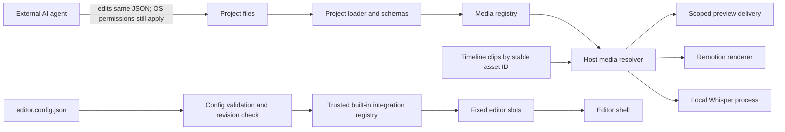
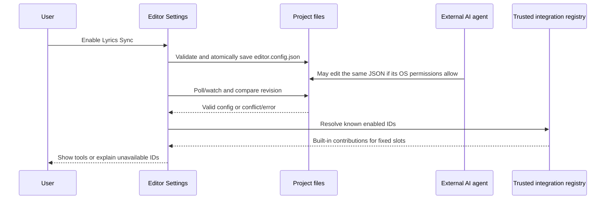

# Proposal: Linked project media and project-enabled editor integrations

Status: proposed, not approved

This proposal follows the product direction in [`management/ROADMAP.md`](../../management/ROADMAP.md), [`management/DECISIONS.md`](../../management/DECISIONS.md), and [`management/BACKLOG.md`](../../management/BACKLOG.md), which are now part of `dev`. PR [#6](https://github.com/MTiberiu/floxbow-motion-studio/pull/6) implemented and merged the reusable subtitle editing integration into `dev` at `bf1f0bfd0ec4e956e6ca86bd2b740d30e78bceb4`. This proposal remains a design proposal; it does not implement the linked-media or project-module contracts below.

## Problem

The current project format can describe project-local source files and an editable timeline, but it has no stable media IDs or project-level editor-module settings. Adding linked media or project-specific tools directly to the desktop shell would spread module-specific logic across the application. A path stored in project JSON also does not give an external AI agent permission to read that file.

The goal is a small, versioned contract for media references and editor integration activation. The editor continues to own its layout; the application continues to load only trusted, built-in code.

## Current implementation

- **Project creation and discovery:** `scripts/project-scaffold.ts` writes a project directory and `project.json`. `scripts/server.ts` calls `discover()` and polls project metadata for the shell. `packages/project-loader/src/index.ts` discovers folders and returns per-project errors.
- **Manifest validation and paths:** `packages/project-loader/src/schema.ts` allows only project-relative paths for `entry`, `timeline`, `editTimeline`, and legacy `audio`. `safeFile()` resolves real paths and rejects traversal or symlink escapes from the project folder. A missing file makes that project report an error; no media registry can retain a missing source while preserving its edits.
- **Timeline and component registration:** `packages/motion-sdk/src/timeline.ts` validates frame-based clips with JSON `content` and `props`; it has no stable media-reference type. Projects explicitly export `editorComponents`; `packages/motion-sdk/src/editor.tsx` renders those registrations. The preview reports serializable field metadata through `motion-editor-v1` in `packages/player/src/host.tsx`.
- **Capabilities discovery:** `packages/animation-library/registry.json` is the structured source read by `apps/desktop/src/CapabilitiesExplorer.tsx`. It documents capabilities but does not register editor UI integrations or enable them per project.
- **Desktop shell:** `apps/desktop/src/main.tsx` owns project navigation and currently imports the lyrics workbench directly. `apps/desktop/src/TimelineEditor.tsx` owns timeline controls, inspector generation and save/reload behavior. There are no named editor extension slots or a project settings file for modules.
- **Preview and render resources:** the preview is served by Vite from the repository root with filesystem strictness enabled; project resources are resolved with project-local `safeFile()` checks. `packages/renderer/src/render.ts` bundles a project entry using Remotion and does not use a shared media resolver. `packages/lyrics-sync/whisper_adapter.py` accepts a filesystem path directly when explicitly run, so it can read only what the local process and OS account can access. These are separate paths, not a unified media API.
- **External edits and conflicts:** Vite watches project files and reloads previews on changes. The editor polls `project.json` and editable timeline state; `scripts/editor-store.ts` uses a content hash, atomic replacement and conflict checks for timeline saves. No editor configuration is watched or conflict-protected yet.

PR #6 added the reusable subtitle component and timing API, editable subtitle timeline clips, schema-driven inspector properties, and tested preview/reload behavior. It did not add linked external media, relinking, packaging, project module activation, a trusted editor integration registry, or general extension slots. The current timeline, preview bridge, renderer, and lyrics package are working connection points that this proposal can preserve.

## Proposed improvement

### 1. Project media references

Add a versioned `media.json` beside `project.json`. Each asset gets a stable project-local ID independent of its path and display name:

```json
{
  "version": 1,
  "assets": [
    {
      "id": "song-main",
      "type": "audio",
      "displayName": "Main song",
      "source": {
        "kind": "external-file",
        "path": "C:\\Users\\Munte\\Music\\song.wav"
      }
    }
  ]
}
```

The source union should also support `project-file` with a path such as `assets/cover.png`. External paths are kept in the platform's native path form as strings; validation must recognize Windows drive and UNC paths as well as POSIX absolute paths, and must never normalize a Windows path with POSIX rules. Absolute external paths are intentionally machine-specific. The UI should report portability as unresolved until an explicit relink or collect/package action exists. No copy, proxy, or package behavior is implied by registering an asset.

Timeline elements should move gradually from raw media URLs to `{ "assetId": "song-main" }`. A media reference is valid only if its ID is in the project registry and its declared type is compatible with the consumer. Existing project-relative URLs and `project.json.audio` remain supported during migration; do not rewrite existing project data automatically.

Define a host-side resolver API in a small media contract module, owned with project loading (candidate export: `@motion/project-loader/media`):

```ts
type MediaPurpose = "preview" | "render" | "transcription";
type MediaResolution =
  | { status: "ready"; assetId: string; type: "audio" | "video" | "image"; path: string }
  | { status: "missing"; assetId: string; displayName: string }
  | { status: "invalid"; assetId: string; message: string };

resolveMedia(projectRoot, registry, assetId, purpose): Promise<MediaResolution>
```

The contract is independent of Electron and React. The dev server, renderer and transcription orchestration provide host adapters; the renderer and Whisper process receive resolved local paths, while the browser preview receives a scoped asset URL or byte stream keyed by asset ID. Do not send local paths into preview messages or create a generic endpoint that accepts arbitrary filesystem paths. Keep each resolution scoped to a registered asset and validate real paths, regular-file type, and requested media type. A missing path reports status and leaves the registry entry, clips and timing intact so the user can relink it later.

Referencing a path is not permission. A user file picker can register a path only after user selection. An external AI agent can read the bytes only if its own process has operating-system access; project JSON does not grant it access. The browser and renderer should not gain arbitrary filesystem access through this contract. A short-lived per-session capability URL may be needed for preview delivery, but loopback ports are not authentication; token exposure, origin checks and lifetime need a security review before implementation.

### 2. Project module configuration

Add a versioned `editor.config.json` as the shared persisted setting for the visual Settings UI and external agents:

```json
{
  "version": 1,
  "modules": {
    "lyrics-sync": true
  }
}
```

The editor owns a static trusted registry, initially in `apps/desktop/src/integrations/registry.ts`. Each registry entry identifies an integration, user-facing name, compatible configuration version, and its allowed UI contributions. The application registry answers **available in this application**; `editor.config.json` answers **enabled for this project**; rendered slot contributions answer **visible in the editor now**. The reusable `subtitles` component is registered by compositions through `editorComponents`; that rendering registration remains separate from any future editor-tool activation. Hiding Lyrics tools must not remove subtitle clips, timing, or rendering code.

Unknown IDs and IDs unavailable in the current application should be ignored for activation and shown as actionable warnings. Preserve unknown keys when the Settings UI writes known settings so an older editor does not erase configuration added by a newer one. Invalid JSON or an unsupported configuration version should fail closed for new tools, preserve existing project content, and offer a readable error. Enabling an ID selects an already-registered implementation; it never installs a package, imports project-provided executable code, or changes filesystem permissions.

The Settings UI and external agent both edit the same `editor.config.json`. Reuse the timeline store's revision pattern: validate, compare the disk revision before save, write atomically, and retain a conflicted UI draft. Watch or poll this configuration separately from `project.json`; after an external valid edit, refresh contributions without rebuilding Electron. An agent should be pointed to the config and API docs by the project's AI task prompt, but the editor must not assume an agent process is present or notify it automatically.

### 3. Fixed editor extension slots

The editor defines a small fixed slot set: `left-tools`, `inspector`, `timeline-actions`, `toolbar`, and `workspace`. A trusted integration may declare contributions to compatible slots. The shell owns ordering, sizing, selection context, and rendering lifecycle; the registry owns the trusted React contribution implementation. `TimelineEditor` and the shell consume generic slot contributions and contain no Lyrics-specific conditional branches.

For the first implementation, mount the existing Lyrics workbench as the `workspace` contribution and expose its action from a stable `left-tools` or `toolbar` contribution. Keep the timeline inspector's existing schema-driven fields available when the workspace is disabled. Do not add user-customizable drag-and-drop placement, dynamic imports derived from project JSON, or arbitrary plugin loading.

### Data flow





## Proposed ownership and API boundaries

| Area                                                                                                     | Owns                                                                                                                 | Must not own                                                                       |
| -------------------------------------------------------------------------------------------------------- | -------------------------------------------------------------------------------------------------------------------- | ---------------------------------------------------------------------------------- |
| `@motion/project-loader` (or a small adjacent project-media package if dependency direction requires it) | Media registry schemas, IDs, path validation, resolution result types, legacy project path compatibility             | React controls, file picking, project-specific clip behavior                       |
| Desktop host/server                                                                                      | User-selected local path registration, scoped preview delivery, config persistence/revisions, warnings and slot host | Arbitrary project code execution or raw-path browser APIs                          |
| `@motion/renderer`                                                                                       | Consuming the shared resolver result for registered assets                                                           | UI and project settings interpretation                                             |
| Lyrics/transcription orchestration                                                                       | Requesting audio by stable asset ID and passing a resolved local path to the worker                                  | Duplicated media path validation or implicit file permissions                      |
| `apps/desktop/src/integrations`                                                                          | Trusted built-in IDs, compatibility and static slot contributions                                                    | Dynamic plugin discovery or implementation ownership for timeline/render contracts |
| `@motion/sdk/timeline` and project compositions                                                          | Persisted timeline clips and explicit visual component registrations                                                 | Editor panel placement or automatic external file access                           |

Keep existing package import paths and `motion-editor-v1` messages compatible. Add optional schema fields or new project files rather than repurposing `project.json.audio`. Resolve external media in host processes; avoid adding filesystem paths to player props or preview bridge messages.

## Backward compatibility and migration

1. Projects without `media.json` or `editor.config.json` load exactly as they do today. Defaults activate no new editor contributions, except any existing shell tab retained during transition.
2. Legacy manifest fields and project-relative media URLs continue to resolve through existing behavior until a separate migration is approved. `project.json.audio` is deprecated only after a reader for both representations and a migration fixture exist.
3. New media references use stable IDs. A migration tool can register existing local assets and rewrite clips only after preview, render, transcription and missing-file behavior are covered by tests. The migration must preserve clip IDs, timing, content and rendering output.
4. Config version 1 is additive. Unknown module IDs remain on disk and produce warnings; older applications must not erase them. Breaking changes require a new config version and explicit migration.
5. Disabling an editor integration affects tool visibility only. It does not remove clips, alter visual component registration, or stop project rendering.

## Risks and alternatives

- **Path portability:** absolute paths break when a project moves between machines. Keep them explicit, mark missing sources, and leave relinking and packaging as separate user actions. A project-relative reference is portable only for files already inside the project.
- **External-file access:** preview serving, Remotion bundling and Whisper run in different processes with different access needs. A shared contract does not itself grant access. Scoped preview delivery and local process permissions need security tests; the existing loopback servers are not authenticated.
- **Stale references:** files can be moved, replaced or changed after registration. Resolver should re-check existence on use and return missing/invalid states instead of deleting edit data. Whether to persist file size/hash/mtime is open; do not treat those values as identity.
- **Unknown module IDs:** ignoring silently hides user intent; failing the whole project discards otherwise valid work. Preserve the key, warn in Settings, and load known modules only.
- **Integration dependencies:** configuration needs may grow (dependencies, compatibility, permissions). Start with stable ID and boolean; add fields only for a concrete use case. Do not infer that all capabilities in Capabilities Explorer are editor panels.
- **Alternative — keep shell tabs hard-coded:** lowest immediate code cost, but every module-specific tool adds conditions to the shell and settings cannot drive the UI. Suitable only if no project-scoped tool is needed.
- **Alternative — dynamic plugin loader:** more flexible but adds code trust, dependency, lifecycle and compatibility problems without a demonstrated need. It is outside this proposal.

## Expected benefit

Projects can describe linked assets and opt into existing editor tools through small files that both humans and external agents can inspect. Preview, renderer and transcription can converge on one validated asset ID contract, while the desktop shell stays responsible for layout and only executes statically registered integrations. Missing media or unknown modules can be reported without silently discarding project edits.

## License considerations

This proposal adds no dependencies, bundled models, media, or third-party implementation code. A later preview/media serving implementation and any user-supplied media integrations require their own dependency and license review.

## Incremental implementation sequence and acceptance

1. **Contract fixtures:** define and validate media registry and editor config schemas, stable IDs, platform paths, unknown module IDs and migration behavior. Acceptance: malformed IDs, traversal, wrong types and unsupported versions fail with clear errors; unknown configuration keys survive a known-setting edit.
2. **Host media resolver:** resolve project-local and explicitly registered external assets into `ready`, `missing` or `invalid` results. Acceptance: missing/moved sources retain timeline JSON; Windows drive/UNC and POSIX paths validate on supported hosts; directories and unregistered paths are refused; no generic raw-path endpoint exists.
3. **Preview/render/transcription adapters:** resolve by asset ID consistently. Acceptance: the same fixture appears in preview and rendered still/video; Whisper receives the resolved audio path; a missing asset produces an actionable error in each consumer without changing edits.
4. **Project settings persistence:** make the visual Settings UI and external file edits share `editor.config.json`. Acceptance: valid external edits refresh UI; invalid edits show errors; concurrent dirty UI edits enter conflict state and remain recoverable; atomic save prevents partial JSON.
5. **Static slots and Lyrics Sync integration:** move Lyrics tools behind a trusted registry contribution and fixed slot host. Acceptance: enabled Lyrics Sync appears in declared slots; disabling it hides tools but preserves project clips, render output and the subtitle inspector; unknown IDs warn; project-provided code is never loaded as an editor integration.

Before implementation, review the browser capability URL threat model, exact path representation on Windows/macOS/Linux, config default semantics, and whether the host resolver belongs in `@motion/project-loader` or a separate package. Keep acceptance checks in the package that owns each contract and run the existing project validation, typecheck, test, build and smoke checks for runtime changes.

## Evidence

- [`docs/ARCHITECTURE.md`](../../docs/ARCHITECTURE.md)
- [`docs/MODULE_INTEGRATION_BLUEPRINT.md`](../../docs/MODULE_INTEGRATION_BLUEPRINT.md)
- [`docs/TIMELINE_EDITOR.md`](../../docs/TIMELINE_EDITOR.md)
- [`packages/project-loader/src/schema.ts`](../../packages/project-loader/src/schema.ts), [`packages/project-loader/src/index.ts`](../../packages/project-loader/src/index.ts)
- [`scripts/server.ts`](../../scripts/server.ts), [`scripts/editor-store.ts`](../../scripts/editor-store.ts)
- [`apps/desktop/src/main.tsx`](../../apps/desktop/src/main.tsx), [`apps/desktop/src/TimelineEditor.tsx`](../../apps/desktop/src/TimelineEditor.tsx)
- [`packages/player/src/host.tsx`](../../packages/player/src/host.tsx), [`packages/motion-sdk/src/timeline.ts`](../../packages/motion-sdk/src/timeline.ts)
- [`packages/renderer/src/render.ts`](../../packages/renderer/src/render.ts), [`packages/lyrics-sync/whisper_adapter.py`](../../packages/lyrics-sync/whisper_adapter.py)
- [`management/ROADMAP.md`](../../management/ROADMAP.md), [`management/DECISIONS.md`](../../management/DECISIONS.md), and [`management/BACKLOG.md`](../../management/BACKLOG.md)

## Acceptance

This is a design proposal only. No runtime contract or schema is implemented by this change. Review and explicit approval are required before stable package, editor, renderer, project, or media behavior changes.
